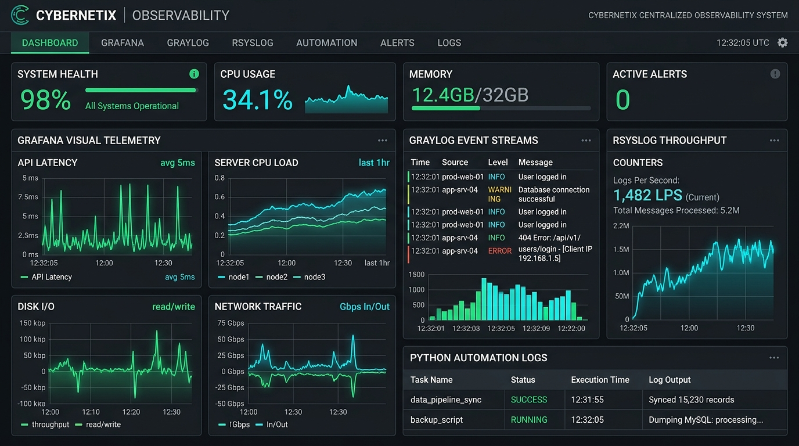

# Mohamed Hamdi — Portfolio

> A modern, component-driven portfolio engineered with **Astro**, **Vanilla CSS Design Tokens**, and **modular JavaScript controllers**. Built to showcase software engineering projects, system architecture, graphic design, and brand identity work.



---

## 💡 Framework Decision: Why Astro?

### Why Not a Single HTML File?
A single file might seem convenient for an instant browser preview, but recruiters who inspect your GitHub repository look closely at code structure, modularity, and toolchain fluency. Monolithic single-file sites create:
- **Severe Code Duplication**: Repeating markup for project cards, tag badges, and modals.
- **High Maintenance Overhead**: Adding or editing content requires navigating thousands of lines of mixed HTML and inline script.
- **Unprofessional Impression**: Shows a lack of experience with standard modern frontend build pipelines.

### Why Astro Instead of Next.js, Create-React-App, or Heavy SPAs?
1. **Zero JavaScript by Default**: Frameworks like Next.js or Create-React-App ship large client-side JavaScript bundles just to render static text and cards. Astro generates **pure, ultra-fast static HTML/CSS** at build time, resulting in sub-second load times and 100/100 Lighthouse performance scores.
2. **Component-Based Modularity**: Reusable, isolated components (`Hero.astro`, `ProjectCard.astro`, `Timeline.astro`, `SkillGrid.astro`) without the performance penalty of client-side hydration.
3. **True Separation of Data, View & Logic (MVC Pattern)**:
   - **Model (`src/data/`)**: Pure JavaScript data files (`projects.js`, `skills.js`, `experience.js`, `profile.js`).
   - **View (`src/components/` & `src/pages/`)**: Clean Astro templates.
   - **Controller (`src/scripts/`)**: Focused, lightweight ES6 client modules (`theme.js`, `filters.js`, `modal.js`).
4. **Islands Architecture**: If needed in the future, you can embed interactive React, Vue, or Svelte components seamlessly without changing the rest of the site.

---

## 🏛️ Project Architecture & Structure

```text
portfolio/
├── dist/                          # Production build output (generated by npm run build)
│   ├── index.html                 # Optimized, minified static HTML
│   ├── _astro/                    # Bundled, fingerprinted CSS & JS assets
│   └── images/                    # Copied project images
│
├── public/                        # Static assets served as-is at root URL
│   ├── images/                    # High-resolution project pictures & mockups
│   │   ├── monitoring-system.jpg  # Python, Grafana, Graylog, Rsyslog dashboard
│   │   ├── desktop-app.jpg        # CodeAnalytics Java & C++ suite
│   │   ├── webapp.jpg             # Zenith Symfony & Angular hub
│   │   ├── branding.jpg           # Aurora brand identity & posters
│   │   └── motion-video.jpg       # Lumina video & motion graphics
│   ├── favicon.ico
│   └── favicon.svg
│
├── src/                           # Application source code
│   │
│   ├── components/                # Modular UI Components (The "View")
│   │   ├── Header.astro           # Sticky glassmorphic navbar & theme toggle
│   │   ├── Hero.astro             # Headline, persona switch, typewriter role
│   │   ├── About.astro            # Dual-craft philosophy & spoken languages
│   │   ├── SkillGrid.astro        # Filterable skills cards (Dev, Des, Biz)
│   │   ├── ProjectCard.astro      # Tactile project preview card with tags
│   │   ├── Timeline.astro         # Academic & professional milestone timeline
│   │   ├── ContactForm.astro      # Direct contact cards & message form
│   │   ├── ProjectModal.astro     # Accessible <dialog> project detail modal
│   │   └── Footer.astro           # Copyright, back-to-top button
│   │
│   ├── data/                      # Structured Data Models (The "Model")
│   │   ├── profile.js             # Personal bio, languages, and mode config
│   │   ├── projects.js            # All projects (titles, tags, images, modal copy)
│   │   ├── skills.js              # Technical & creative skills with levels
│   │   └── experience.js          # Journey timeline (internships, education)
│   │
│   ├── pages/                     # Routing
│   │   └── index.astro            # Home page assembling all components
│   │
│   ├── scripts/                   # Client-Side Interactive Logic (The "Controller")
│   │   ├── theme.js               # Dark / Light mode switching & persistence
│   │   ├── filters.js             # Persona switch, typewriter, category filters
│   │   └── modal.js               # Project modal dialog opening/closing logic
│   │
│   └── styles/                    # Design System & Stylesheets
│       ├── tokens.css             # CSS custom properties (colors, fonts, radius)
│       └── global.css             # Base resets, typography, buttons, grids
│
├── astro.config.mjs               # Astro framework configuration
├── package.json                   # Dependencies, scripts, and project metadata
├── package-lock.json              # Deterministic npm dependency tree
├── tsconfig.json                  # TypeScript / Astro editor support
├── README.md                      # Markdown documentation for GitHub
└── README.txt                     # Plain text documentation
```

---

## ⚡ Adding a New Project in 30 Seconds

Adding a project requires **zero markup editing**:

1. Drop your project image into:
   ```text
   public/images/your-project-name.jpg
   ```
2. Open [`src/data/projects.js`](file:///d:/portfolio/src/data/projects.js) and append an entry:
   ```javascript
   {
     id: "your-project-id",
     title: "Your Project Name",
     category: "dev", // "dev" for Software Engineering, "des" for Graphic Design / Motion
     categoryLabel: "Observability & DevOps",
     summary: "Short one-sentence teaser displayed on the project card.",
     description: "In-depth overview displayed inside the interactive modal.",
     tags: ["Python", "Grafana", "Graylog", "Rsyslog"],
     image: "/images/your-project-name.jpg",
     link: "https://github.com/mohamedhamdi/your-repo",
     features: [
       "Key architectural highlight or benchmark",
       "Database or concurrency optimization",
       "User interface milestone"
     ]
   }
   ```
3. Save the file. The card, tags, category filter, and modal will update automatically.

---

## 🛠️ Getting Started & Commands

### Prerequisites
- **Node.js** `>= 22`
- **npm** `>= 10`

### Installation & Development
```bash
# Install dependencies
npm install

# Start local dev server (live reload at http://localhost:4321)
npm run dev

# Compile optimized static output into ./dist/
npm run build

# Preview production build locally
npm run preview
```

---

## 🚀 One-Click Deployment

This project compiles to static HTML/CSS/JS in `./dist/` and deploys easily to any host:

- **Vercel**: Connect your GitHub repository and select the default **Astro** preset.
- **Netlify**: Set build command to `npm run build` and publish directory to `dist`.
- **GitHub Pages**: Deploy the `dist/` directory via GitHub Actions.

---

## 👤 Author

**Mohamed Hamdi**  
- **Role**: Software Engineering Student & Freelance Graphic Designer  
- **University**: ESPRIT School of Engineering (Ariana, Tunisia)  
- **Email**: [mh8180038@gmail.com](mailto:mh8180038@gmail.com)  
- **LinkedIn**: [mohamed-hamdi](https://www.linkedin.com/in/mohamed-hamdi-204956294/)  
- **Behance**: [mohamed hamdi](https://www.behance.net/)  
- **GitHub**: [mohamedhamdi](https://github.com/mohamedhamdi)  
